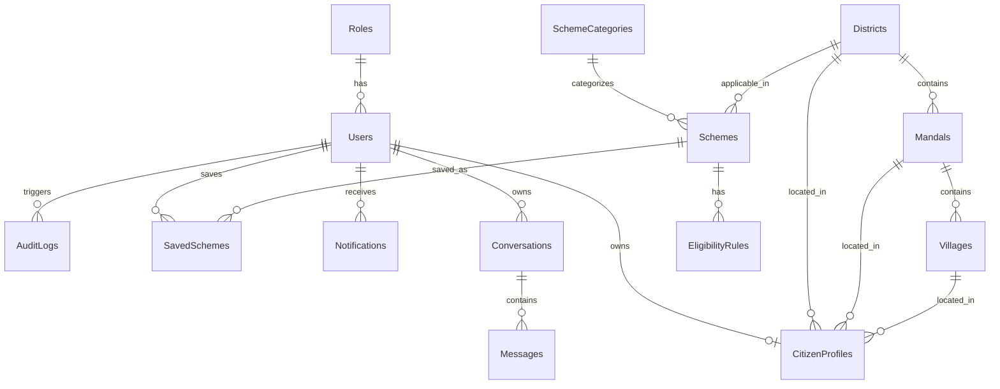

# GramAI - Database Architecture

## 1. Database Overview
The GramAI database is designed to securely and efficiently store data related to citizens, government schemes, interactions with the AI assistant, and geographical data specific to Telangana. It uses PostgreSQL as the relational database, accessed via SQLAlchemy 2.0 ORM.

## 2. Database Design Principles
- **Telangana Exclusive Hierarchy:** The geographical structure strictly follows `District -> Mandal -> Village` to ensure localized recommendations. State and Country tables are intentionally omitted.
- **Unified Profile:** A single `CitizenProfile` table manages all demographic data (Farmer, Student, Senior Citizen flags are derived from unified fields like Occupation, Age, etc.).
- **Soft Deletes:** Critical records use soft delete patterns (`is_active` or `deleted_at`) rather than hard deletion to preserve audit trails.
- **Audit Trails:** Timestamping (`created_at`, `updated_at`) exists on all tables, and sensitive operations are logged in `AuditLogs`.
- **Normalization:** The database is highly normalized (3NF) to reduce redundancy. Scheme data is separated into Categories, Rules, and the Schemes themselves.

## 3. ER Diagram (Entity Relationship)

## 4. Relationship Diagram & Constraints

### Core Relationships
- `Users` (1) <-> (1) `CitizenProfiles`: A user (if a citizen) has exactly one profile. Admins do not require a `CitizenProfile`.
- `Roles` (1) <-> (N) `Users`: Defines RBAC (Super Admin, Mandal Admin, Village Admin, Citizen).
- `Schemes` (1) <-> (N) `EligibilityRules`: A scheme has multiple rules processed by the AI.

### Foreign Keys & Constraints
- `CitizenProfile.district_id` -> `Districts.id` (ON DELETE SET NULL)
- `CitizenProfile.mandal_id` -> `Mandals.id` (ON DELETE SET NULL)
- `CitizenProfile.village_id` -> `Villages.id` (ON DELETE SET NULL)
- `Mandal.district_id` -> `Districts.id` (ON DELETE CASCADE)
- `Village.mandal_id` -> `Mandals.id` (ON DELETE CASCADE)
- `Users.role_id` -> `Roles.id` (ON DELETE RESTRICT)

### Primary Keys
- All tables use `id` (UUID or Auto-increment Integer depending on scale, default Integer for fast indexing on relational joins). UUIDs will be used for `Users` and `Conversations` for external security.

### Indexes Strategy
- **Primary Indexes:** Created automatically on PK fields.
- **Foreign Key Indexes:** Explicitly created on FKs (e.g., `role_id`, `district_id`, `mandal_id`, `village_id`) to speed up join operations.
- **Search Indexes:** Created on frequently searched fields like `CitizenProfiles.mobile_number`, `Schemes.status`, and `Schemes.category_id`.
- **Composite Indexes:** For analytics, e.g., on `(district_id, mandal_id)`.

## 5. Table Descriptions
1. **Roles:** Defines user authorization levels.
2. **Users:** Core authentication table (Email/Phone, Password hash).
3. **CitizenProfiles:** Unified table holding all demographic data required for the Recommendation Engine.
4. **Districts/Mandals/Villages:** Telangana geographical hierarchy.
5. **SchemeCategories:** Taxonomy of schemes (e.g., Agriculture, Education, Pensions).
6. **Schemes:** Details of government benefits.
7. **EligibilityRules:** Discretized rules for AI consumption.
8. **SavedSchemes:** User bookmarked schemes.
9. **Notifications:** System alerts for users.
10. **Conversations/Messages:** Logs of AI Voice Assistant chats.
11. **WeatherCache/MarketPrices:** Cached external dataset data.
12. **AuditLogs:** Security and modification logging.
