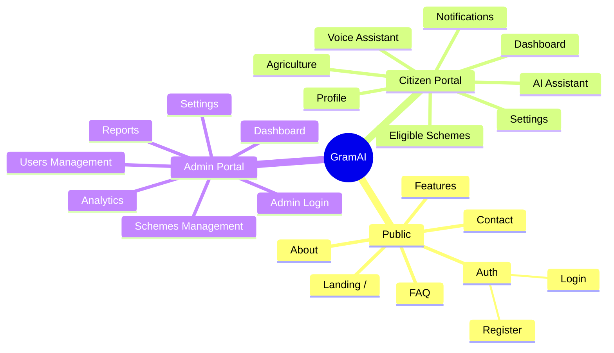

# GramAI Sitemap

The GramAI platform is divided into three primary zones: Public, Citizen, and Admin. This sitemap defines the navigational structure and hierarchy of the application.

## Detailed Path Mappings

### 1. Public Routes
- **`/`**: Home/Landing page explaining GramAI benefits.
- **`/about`**: About the initiative.
- **`/features`**: Detailed feature list.
- **`/faq`**: Frequently asked questions.
- **`/contact`**: Support contact forms.
- **`/login`**: Unified login portal.
- **`/register`**: New citizen registration.

### 2. Citizen Routes (Protected)
- **`/citizen`**: Main dashboard (Overview of saved schemes, active notifications).
- **`/citizen/profile`**: Citizen demographic data collection.
- **`/citizen/schemes`**: Catalog of schemes eligible for the user.
- **`/citizen/agriculture`**: Dedicated market prices and weather tools for Farmers.
- **`/citizen/chat`**: Text-based AI assistant interface.
- **`/citizen/voice`**: Voice-first AI interaction screen.
- **`/citizen/notifications`**: System alerts.
- **`/citizen/settings`**: Language preferences (Telugu/English), theme settings.

### 3. Admin Routes (Protected - RBAC)
- **`/admin/login`**: Dedicated secure login for administrators.
- **`/admin`**: Admin dashboard (Metrics, quick actions).
- **`/admin/users`**: Manage citizens and lower-level admins.
- **`/admin/schemes`**: Create, edit, toggle government schemes.
- **`/admin/analytics`**: Usage statistics and AI performance graphs.
- **`/admin/reports`**: Downloadable CSV/PDF mandate reports.
- **`/admin/settings`**: System configurations.
